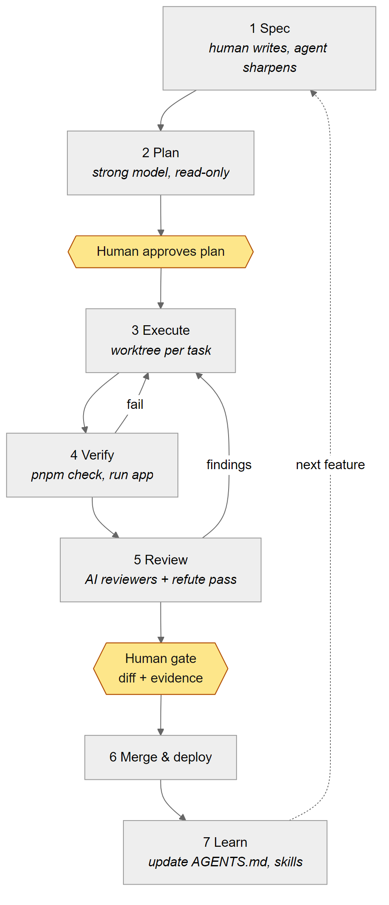

# agentic-shortlink

A small URL shortener API, built as the hands-on project for the blog series
**"Shipping software with AI agents, A to Z"** on [luonghongthuan.com](https://luonghongthuan.com/en/blog/).

The app is deliberately small. The interesting part is everything around it: how the repo is set up so
Claude Code, Codex and other agents can work in it quickly without losing control of quality.



## The series

Watch the whole series as one video: [English (25 min)](https://youtu.be/9YlPszIyBkM) · [Tiếng Việt (21 phút)](https://youtu.be/2cQeWVnvYWI)


1. Architecture and model roles: [English](https://luonghongthuan.com/en/blog/agentic-dev-a-z-01-architecture-models/) · [Tiếng Việt](https://luonghongthuan.com/vi/blog/agentic-dev-a-z-01-architecture-models/)
2. Repo setup for Claude Code and Codex: [English](https://luonghongthuan.com/en/blog/agentic-dev-a-z-02-repo-setup/) · [Tiếng Việt](https://luonghongthuan.com/vi/blog/agentic-dev-a-z-02-repo-setup/)
3. Spec, plan, tasks: [English](https://luonghongthuan.com/en/blog/agentic-dev-a-z-03-spec-plan-tasks/) · [Tiếng Việt](https://luonghongthuan.com/vi/blog/agentic-dev-a-z-03-spec-plan-tasks/)
4. Parallel agents, multiple providers: [English](https://luonghongthuan.com/en/blog/agentic-dev-a-z-04-parallel-multi-provider/) · [Tiếng Việt](https://luonghongthuan.com/vi/blog/agentic-dev-a-z-04-parallel-multi-provider/)
5. CI/CD with AI review: [English](https://luonghongthuan.com/en/blog/agentic-dev-a-z-05-cicd-ai-review/) · [Tiếng Việt](https://luonghongthuan.com/vi/blog/agentic-dev-a-z-05-cicd-ai-review/)
6. Operating it: cost, security, learning: [English](https://luonghongthuan.com/en/blog/agentic-dev-a-z-06-operate-cost-security/) · [Tiếng Việt](https://luonghongthuan.com/vi/blog/agentic-dev-a-z-06-operate-cost-security/)

## Quick start

```bash
git clone https://github.com/luonghongthuan/agentic-shortlink
cd agentic-shortlink
corepack enable            # gives you the pinned pnpm
pnpm install
pnpm check                 # lint + typecheck + tests
cp .env.example .env       # set ADMIN_API_KEY to 8+ characters
pnpm dev
```

```bash
curl -s -X POST localhost:3000/api/links -H 'content-type: application/json' \
  -d '{"url":"https://example.com","slug":"demo","expiresInDays":7}'
curl -i localhost:3000/demo
curl -s localhost:3000/api/links/demo
```

## API

| Method | Path | Notes |
| --- | --- | --- |
| `POST` | `/api/links` | body `{ url, slug?, expiresInDays? }` -> 201, 400, 409 |
| `GET` | `/:slug` | 302 to the URL; 404 unknown; 410 expired (spec 0001) |
| `GET` | `/api/links/:slug` | stats: `clicks`, `expiresAt`, `expired` |
| `DELETE` | `/api/links/:slug` | header `x-api-key: $ADMIN_API_KEY` -> 204 |
| `GET` | `/health` | `{ "status": "ok" }` |

## What is in the repo

| Path | Purpose | Series part |
| --- | --- | --- |
| `AGENTS.md` | Shared instructions for every agent (Codex reads it directly) | 2 |
| `CLAUDE.md` | Imports `AGENTS.md`, adds Claude Code notes | 2 |
| `.claude/settings.json`, `.claude/hooks/` | Permissions, a guard hook that blocks `git push` / `git add -A` / `rm -rf`, auto-format | 2 |
| `.claude/agents/` | `reviewer` and `refuter` subagents | 2, 4 |
| `.claude/skills/` | `new-spec` and `implement-spec` workflows | 3 |
| `.codex/config.toml`, `examples/codex/` | Codex project config, profiles, gateway provider | 2, 4 |
| `docs/specs/`, `docs/tasks/` | Spec template, spec 0001 (done), spec 0002 (exercise) | 3 |
| `scripts/agent-task.sh` | Run one task headless in its own worktree with Claude or Codex | 4 |
| `scripts/cross-review.sh` | Review a branch with two model families, keep findings that survive | 4 |
| `gateway/litellm.config.yaml` | One gateway for Anthropic, OpenAI, Gemini and local models | 4 |
| `.github/workflows/` | CI gate, Claude review, Codex review, `@claude` mentions | 5 |
| `docs/diagrams/` | Mermaid sources and PNGs used in the posts | all |

## Exercise

Implement [spec 0002, daily click stats](docs/specs/0002-daily-click-stats.md) with your agent of choice,
following parts 3 to 5. A reference solution is on branch
[`solution/0002-daily-stats`](https://github.com/luonghongthuan/agentic-shortlink/tree/solution/0002-daily-stats).

## Enabling the AI review workflows on your fork

1. Add repository secrets `ANTHROPIC_API_KEY` and/or `OPENAI_API_KEY`.
2. Add repository variable `ENABLE_AI_REVIEW` = `true`.
3. Open a pull request from a branch in the same repo (secrets are not passed to fork PRs).

Every action is pinned to a commit SHA; Dependabot keeps the pins fresh.

## License

MIT
